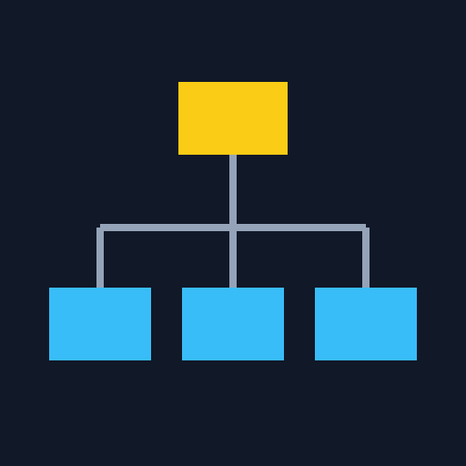

<div align="center">



# ai-organization: a Claude Code skill that runs your project like a top company

**Multi-agent orchestration for Claude Code.** Claude becomes the CEO of an AI team: it sizes the job, hires only the specialist subagents it needs, vets their skills, applies Andrej Karpathy's methods, gates code on modern CI/CD, and ships only after independent QA.

[](https://github.com/azharudh33n/ai-organization/actions/workflows/ci.yml)
[](https://github.com/azharudh33n/ai-organization/releases)
[](LICENSE)
[](https://code.claude.com/docs/en/plugins-reference)
[](https://agentskills.io/specification)

[Website](https://azharudh33n.github.io/ai-organization/) · [Install](#install) · [How it works](#how-it-works) · [Benchmarks](docs/evolution/benchmark.md) · [FAQ](#faq)

</div>

---

## Why ai-organization?

Asking one AI agent to "build the whole thing" tends to produce unverified work, bloated plans and wasted tokens. ai-organization gives Claude Code the operating model of a well-run company instead:

- **Right-sized teams.** A README fix stays a one-person job. A regulated web app gets architects, engineers, DevOps, security and QA. The skill picks a Solo, Squad or Company tier before it hires anyone.
- **Separation of duties.** Whoever builds something never grades it. Benchmarks, acceptance tests, code review and fact-checking always go to a different agent.
- **Karpathy's operating system.** Think before acting, simplicity first, surgical changes, and goal-driven execution with checks that pass or fail. The Karpathy Loop handles any numeric goal.
- **Production-grade CI/CD from day one.**
  - Trunk-based flow, required checks and merge queues.
  - Actions pinned to commit SHAs, least-privilege tokens and OIDC.
  - SLSA provenance and SBOM attestations.
  - Preview environments and canary releases with automatic rollback.
- **Independent QA.** A fresh agent that never saw the build checks every Definition of Done item and records evidence.
- **Token-efficient.** The core skill loads about 2k tokens. Department playbooks load only when that department is staffed.

## Results

Measured against the original single-file version on the [eval suite](evals/) (details and caveats in [benchmark.md](docs/evolution/benchmark.md)):

| | v0 (original) | v1 (this repo) |
|---|---|---|
| Tokens loaded when the skill triggers | ~4,351 | **~2,166 (−50%)** |
| Eval assertions passed | 14/17 (82%) | **16/17 (94%)** |
| Small task: time, and planning files written | 125 s, 9 files | **39 s, 0 files** |
| Web app plan: tasks detailed up front | 97 | **30** (rolling-wave planning) |

## Install

**Claude Code plugin** (recommended):

```text
/plugin marketplace add azharudh33n/ai-organization
/plugin install ai-organization@ai-organization
```

**Manual install** (Claude Code, any project):

```bash
git clone https://github.com/azharudh33n/ai-organization
cp -r ai-organization/skills/ai-organization ~/.claude/skills/
```

**Claude app (claude.ai):** download `ai-organization-skill.zip` from the [latest release](https://github.com/azharudh33n/ai-organization/releases/latest) and upload it as a custom skill in the Claude app. Each release zip carries a build provenance attestation. To check one, run `gh attestation verify ai-organization-skill.zip -R azharudh33n/ai-organization`.

## Quick start

```text
Use the ai-organization skill. Run this project the way a top company would.

PROJECT: <what you want built or made>
DELIVERABLES: <e.g. working web app + 60s promo video + launch doc>
AUDIENCE: <who it's for>
CONSTRAINTS: <stack, brand, deadline, budget, compliance>
QUALITY BAR: world-class. Nothing ships without independent QA evidence.

Ask me only if a wrong guess would be expensive. Otherwise decide, note
your assumption, and keep going. Update me at each phase.
```

You can also just describe the project. The skill triggers on requests like "build an AI team for this", "run this like a company" or "plan and deliver this end to end".

## How it works

1. **Size the job:** Solo (just do it and verify), Squad (2–4 hires, one brief file) or Company (full org, every gate).
2. **Brief and Definition of Done:** 5–10 criteria, each one a test, metric or inspection.
3. **Org chart:** the smallest team that covers every DoD item without letting builders grade their own work.
4. **Talent sourcing:** most roles need only a good brief. When one needs a skill, it comes from the project's committed roster or from [skills.sh](https://skills.sh), and only after it passes the vetting gate (below). It is installed pinned to a commit and committed to the repo.
5. **Hiring:** one job brief per subagent, with success criteria, boundaries and a handoff of 200 words or less.
6. **Plan and execute:** rolling-wave plan, parallel lanes, the CI/CD pipeline before any feature work, and the Karpathy Loop for metric goals.
7. **Independent QA:** a fresh agent that never saw the build checks every DoD item and records evidence.
8. **Review board, delivery and retro:** you approve anything irreversible (deploys, publishing, spending money) before it happens.

### What's inside

| File | Loaded when |
|---|---|
| [`SKILL.md`](skills/ai-organization/SKILL.md) | Always, when the skill triggers (~2k tokens) |
| [`templates.md`](skills/ai-organization/references/templates.md) | Writing the brief, org chart, job briefs, plan or ADRs |
| [`talent-sourcing.md`](skills/ai-organization/references/talent-sourcing.md) | A role needs a skill: roster, skills.sh search, vetting gate, pinned install |
| [`scripts/vet_skill.py`](skills/ai-organization/scripts/vet_skill.py) | Run before installing any third-party skill |
| [`playbook-engineering.md`](skills/ai-organization/references/playbook-engineering.md) | Engineers are hired |
| [`cicd.md`](skills/ai-organization/references/cicd.md) | Any software deliverable: pipeline, supply chain, deployment, DORA metrics |
| [`playbook-research.md`](skills/ai-organization/references/playbook-research.md) | Research or benchmarking |
| [`playbook-creative.md`](skills/ai-organization/references/playbook-creative.md) | Video, design or UI work |
| [`karpathy-loop.md`](skills/ai-organization/references/karpathy-loop.md) | A DoD item is a number, or Data/ML hires |
| [`qa-and-review.md`](skills/ai-organization/references/qa-and-review.md) | QA, review board and retro |

## Skill sourcing for cloud sessions

A cloud or CI session starts with nothing but your repo, so the skills a team needs have to live in the repo. ai-organization handles that with the [`skills`](https://skills.sh) CLI and a vetting gate:

1. **Roster first.** Skills already committed under `.claude/skills/` (tracked in `skills-lock.json`) are used as they are.
2. **Search.** `npx skills find "<stack or task>"` on skills.sh.
3. **Vetting gate.** `vet_skill.py` reads the independent security audits skills.sh publishes (Snyk, Socket, Gen Agent Trust Hub and others) and checks that the publisher is a verified GitHub organization. The verdict comes from those outside facts, not from the model's reading of the skill.
4. **Pinned install.** Approved skills are installed at an exact commit, with a content hash in `skills-lock.json`, and committed so every later session has them.

| Gate verdict | When | With you there | Unattended |
|---|---|---|---|
| `approved` | All audits pass at low risk, verified publisher | Installs | Installs |
| `ask` | Unverified publisher, or an audit warns | Asks you | Logs a proposal and carries on without it |
| `rejected` | An audit fails, high risk, or no audits | Never installs | Never installs |

Popularity is not safety. When this gate was built, the top skills.sh result for "playwright testing" had thousands of installs and a failing Snyk audit, and the gate rejected it.

## Evals

The [`evals/`](evals/) folder holds test cases in the layout `claude plugin eval` reads. Each case is a planning dry run, so the suite is cheap enough to run often:

| Case | What it checks |
|---|---|
| `webapp-ci-cd-plan` | A checkable DoD, a lean team, CI gates, supply-chain controls, preview/staging with rollback, separation of duties, and privacy |
| `tiny-task-right-sizing` | The skill scales down for a 2-line README fix |
| `research-report-plan` | Research-led staffing, triangulated sources, a fixed benchmark harness, and no invented numbers |

```bash
claude plugin eval . --allow-tools Write,Edit   # real, billed model runs
```

## Quality and security of this repo

Every push and PR runs [`ci.yml`](.github/workflows/ci.yml):

- the skill validator and its unit tests (frontmatter rules, token budget, reference links, version consistency)
- `claude plugin validate --strict`
- markdownlint
- lychee link checking
- zizmor and actionlint

All actions are pinned to commit SHAs with read-only default permissions, and Dependabot proposes updates after a 7-day cooldown. Releases are built in CI and published with a [SLSA build provenance attestation](https://docs.github.com/en/actions/concepts/security/artifact-attestations). Report vulnerabilities as described in [SECURITY.md](SECURITY.md).

## FAQ

**What is a Claude Code skill?**
A skill is a folder with a `SKILL.md` file that Claude loads when a task matches its description. It follows the open [Agent Skills specification](https://agentskills.io/specification). ai-organization is a skill packaged as a Claude Code plugin.

**How is this different from just using subagents?**
Subagents are the workers. ai-organization is the management layer: it decides how many to hire, what each one may touch, which skills they load, and what evidence counts as done. It also keeps builders from grading their own work.

**Does it work without subagents, for example on claude.ai?**
Yes. Claude plays each role in sequence, announces each switch, and keeps the same briefs and gates.

**Will it burn through my tokens?**
It was designed not to. Small jobs skip the ceremony entirely, playbooks load on demand, handoffs are capped at 200 words, and plans are detailed one milestone at a time. On the eval suite it used less time and fewer tokens than the original.

**Which models does it support?**
Any Claude model that supports skills. It tells Claude to use smaller models for mechanical roles and the strongest model for architecture and final review.

**Can I use it for non-software projects?**
Yes. It has playbooks for research reports, benchmarks, video production and design, and it only staffs the departments a project needs.

## Contributing

Issues and PRs are welcome. See [CONTRIBUTING.md](CONTRIBUTING.md). If you change the skill, run the validator and, if you can, the eval suite, and include the numbers in your PR.

## Credits

Built on ideas from Andrej Karpathy (coding guidelines, [autoresearch](https://github.com/karpathy/autoresearch), the neural-net training recipe), [`obra/superpowers`](https://github.com/obra/superpowers) and [`anthropics/skills`](https://github.com/anthropics/skills). v1 evolves the author's original single-file ai-organization skill (v0).

If this saves you time, a ⭐ helps other people find it.

## License

[MIT](LICENSE) © azharudh33n
